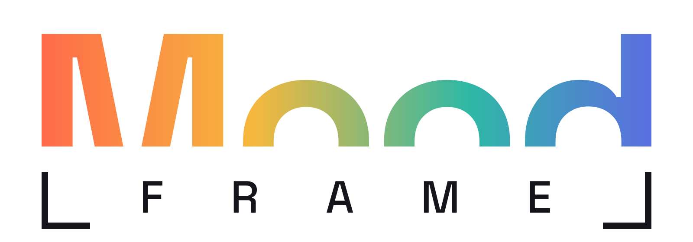
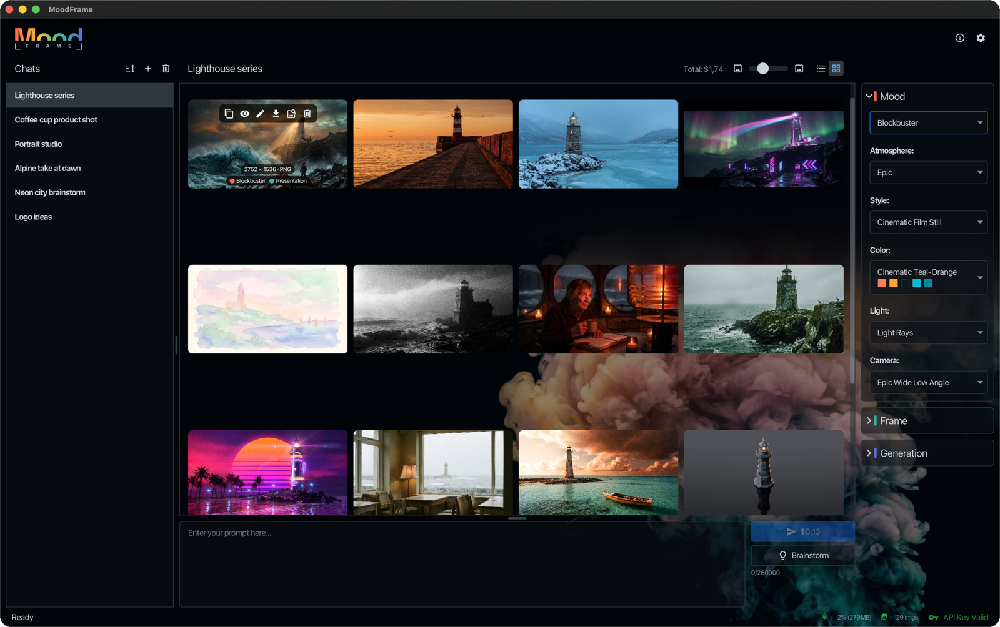
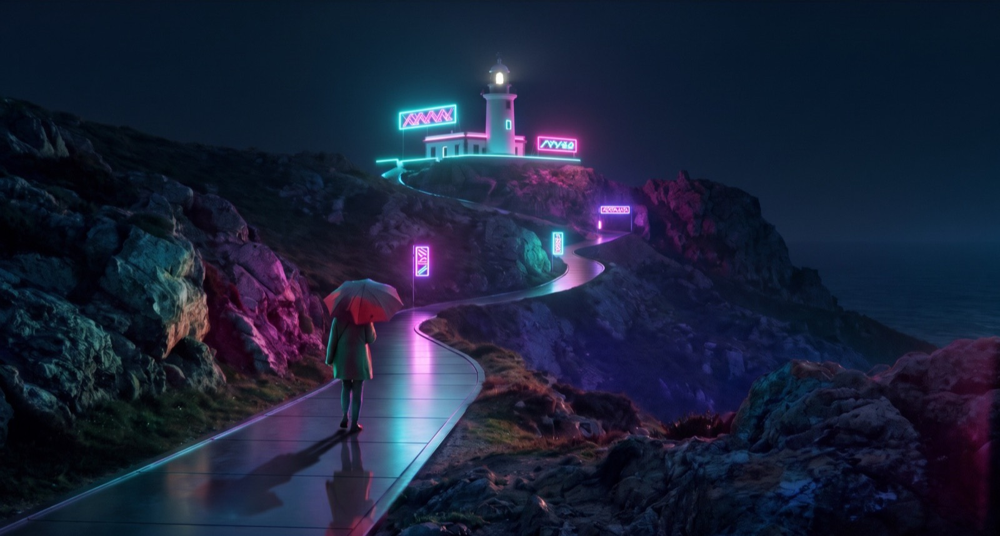
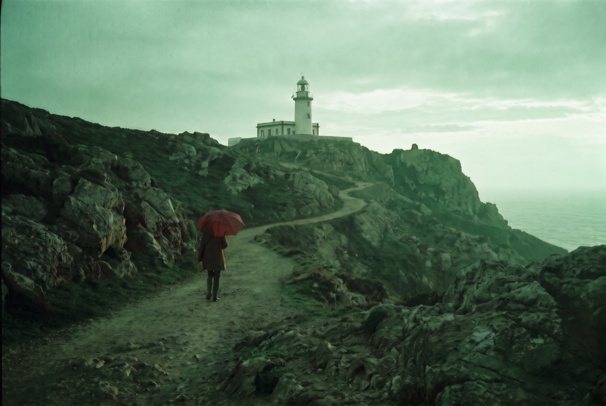
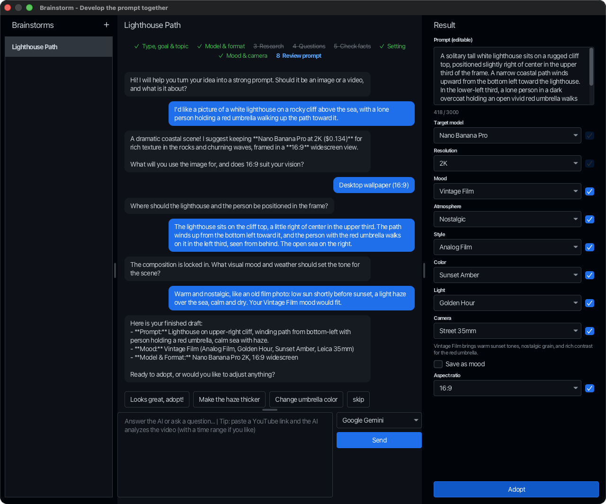

<p align="center">
  <a href="https://moodframe.art">
    <picture>
      <source media="(prefers-color-scheme: dark)" srcset="assets/moodframe-logo-on-dark.svg">
      
    </picture>
  </a>
</p>

<p align="center"><b>Mood in. Frame out.</b><br>
<a href="https://moodframe.art">moodframe.art</a></p>

MoodFrame is a desktop studio for AI images. The mood sets how an image feels, the frame its shape and size. One app
for FLUX, Nano Banana, OpenAI and any compatible image API.

<p align="center"></p>

## Mood: switch the mood, keep the picture

A mood is made of building blocks: atmosphere, style, color, light and camera. Each block can be locked, your own
blocks and moods sit next to the built-in ones, and "Mood from image" takes the mood from any picture you drop in.

| Vintage Film | Quiet Morning | Sci-Fi Cinema | Film Noir | Wild North |
|---|---|---|---|---|
|  |  |  |  |  |

Vintage Film is generated from a prompt; the other four use it as reference image (Edit). Nano Banana Pro.

## Frame: say the format once

A frame is a target aspect ratio and resolution, saved by name, with seven built-in frames. Every model takes its
closest aspect ratio and resolution, and the app shows which one before you generate. For the frame Presentation
(16:9, 2K), FLUX.2 [pro] and Nano Banana Pro make 16:9, OpenAI gpt-image makes 3:2. The library can be grouped by
frame.

## Brainstorm: from a rough idea to a finished prompt

A guided chat with Gemini or an OpenAI-compatible model works out the scene with you.

<p align="center"></p>

1. **Describe your idea:** a sentence is enough, or a link to a YouTube video.
2. **Answer a few questions:** the assistant asks back, researches the web and checks the facts.
3. **Adopt the draft:** prompt, mood, model and resolution go to the main window with one click.
4. **Next round:** ask for the next image; one chat can plan a whole series.

It knows your moods and building blocks, watches the YouTube videos you link in the time range you choose (Gemini),
and keeps every brainstorm; several run side by side.

## And there's more

- **Combine and edit:** attach up to 10 images (depending on the model) for a collage, a combination or an edit with a
  new prompt or mood
- **Infographics:** Brainstorm gathers the facts from the web or a YouTube video and lays them out as an infographic,
  with the frame Text in Image
- **Camera dialog:** camera type, focal length, aperture, perspective and shot size, with an example image for every
  stage
- **Video:** video clips with Gemini Omni, in the same chats as your images
- **Costs in view:** the price shows before you send, the costs per image and per chat afterwards
- **One trash:** chats, images, building blocks, moods and frames, all restorable
- **Share moods:** export your moods as a file and import them on another machine
- **Seven themes:** light and dark, from Primer and Nord to Cupertino and Dracula
- **Corporate networks:** proxy settings and your own root certificates, also for networks with TLS inspection

## Models: bring your own API key

| Provider | Models |
|---|---|
| Black Forest Labs | FLUX 3 · FLUX.2 |
| Google Gemini | Nano Banana · Omni video · Brainstorm |
| OpenAI | OpenAI or your own compatible gateway |

Your keys stay on your machine, encrypted.

## Install

The installers bring their own Java runtime. MoodFrame checks for updates on every launch and updates itself.

**macOS:** paste into a terminal; the command downloads MoodFrame, installs it in Applications and starts it.

```bash
curl -L https://moodframe.art/download/launch.mac | bash
```

A download in the terminal carries no quarantine flag, so macOS opens the app right away. The app is not notarized by
Apple: if you download the .zip from [moodframe.art](https://moodframe.art/#install) instead, macOS blocks the first
launch; then click Open Anyway in System Settings → Privacy & Security.

**Windows:** [download and run the installer](https://moodframe.art/download/moodframe.exe), which also keeps MoodFrame
up to date.

**Linux (Debian, Ubuntu):** updates come with apt; for the current version see
[moodframe.art](https://moodframe.art/#install), other distributions find a .tar.gz there.

```bash
CPU=$(dpkg --print-architecture)
wget https://moodframe.art/download/debian/moodframe_2.0.0_${CPU}.deb
sudo apt install ./moodframe_2.0.0_${CPU}.deb
```

## Written entirely by AI

Not one line of MoodFrame's code was typed by a human.

- **Planned together:** a person plans every task together with the AI: what (function, UI and UX), how (architecture)
  and when it is done (the goals to reach).
- **Written by AI agents:** the agents write the code with [Claude Code](https://claude.ai) and the
  [ASE](https://ase.tools) agent fleet and deliver the evidence that it is right: tests, an automated review and visual
  checks.
- **Accepted on evidence:** the person checks that evidence, not the code, and then tries the change live in the app.

About 36,000 lines of Java code, 8,000 lines of test code and 397 automated tests.

## Build and run

Requirements: Java 21 and an API key for at least one provider (BFL, Google Gemini, or an OpenAI-compatible endpoint).

```bash
./gradlew run      # start the app
./gradlew test     # run the tests
```

API keys are entered in the settings and stored encrypted in `~/.moodframe/config.properties`. The key for that
encryption is created per installation in `~/.moodframe/secret.key`. You can also pass keys as environment variables
(`BFL_API_KEY`, `GEMINI_API_KEY`, `OPENAI_API_KEY`).

## Packaging

Installers for macOS, Windows and Linux are built with [Conveyor](https://conveyor.hydraulic.dev) (`conveyor.conf`):

```bash
./gradlew deploy
```

Conveyor is free for open source projects: `app.vcs-url` points to this public repository, and the build confirms that
with Conveyor's license server. Conveyor uses its own trust store, so behind a TLS-inspecting proxy the build stops
with `Could not contact license server`; import the proxy's root certificate into Conveyor's
`runtime/Contents/Home/lib/security/cacerts` with `keytool`.

The download site is written to `build/packages/moodframe-<version>/`. Upload its content to
`https://moodframe.art/download` (`app.site.base-url`); installed apps check that address for updates on every launch.
The website itself is in [`website/`](website/).

## License

[MIT](LICENSE) © [Matthias Brusdeylins](https://brusdeylins.info). The logo is set in Space Grotesk (SIL Open Font License).

Built with Agentic Coding using [Claude Code](https://claude.ai) and [ASE](https://ase.tools).
