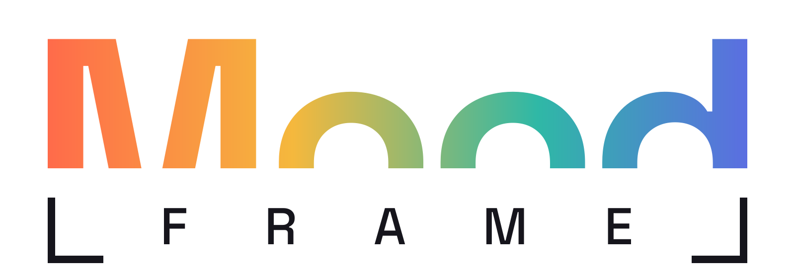
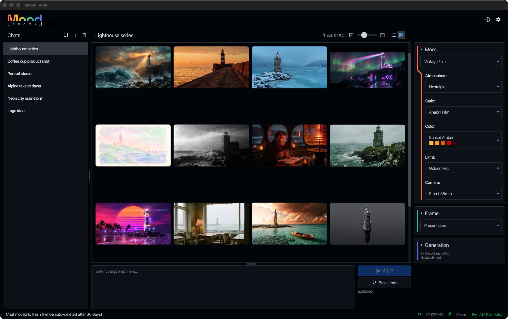
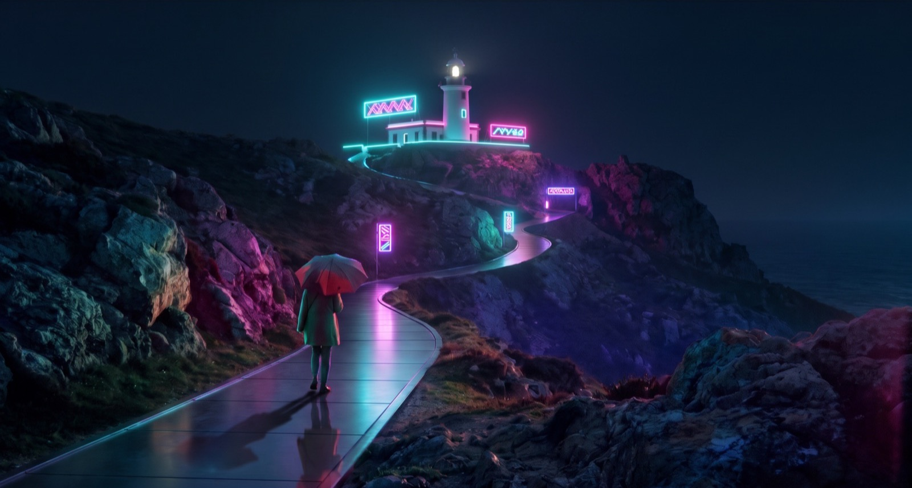
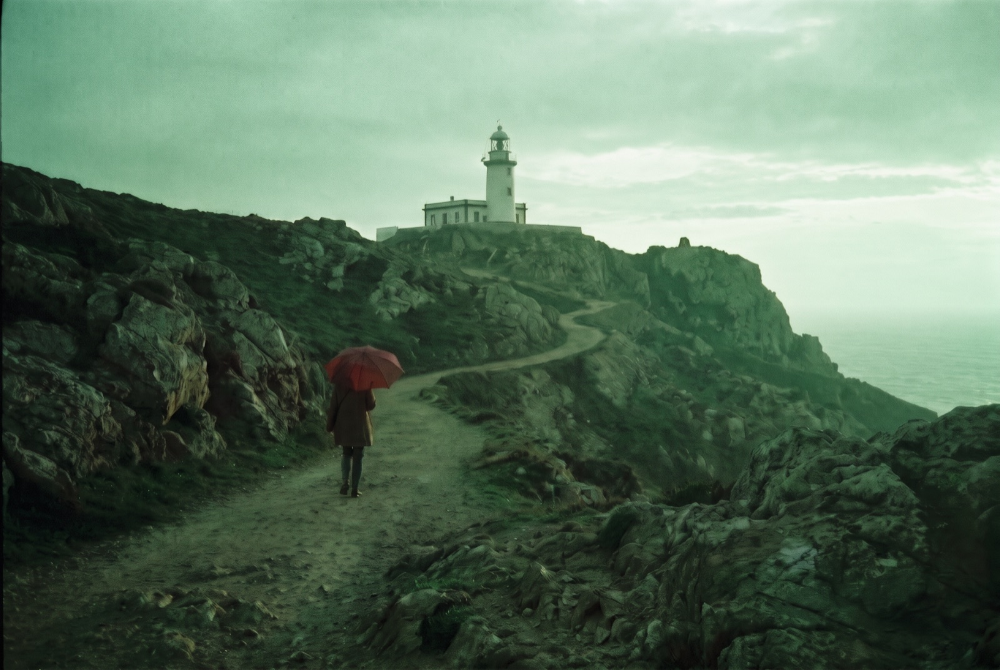
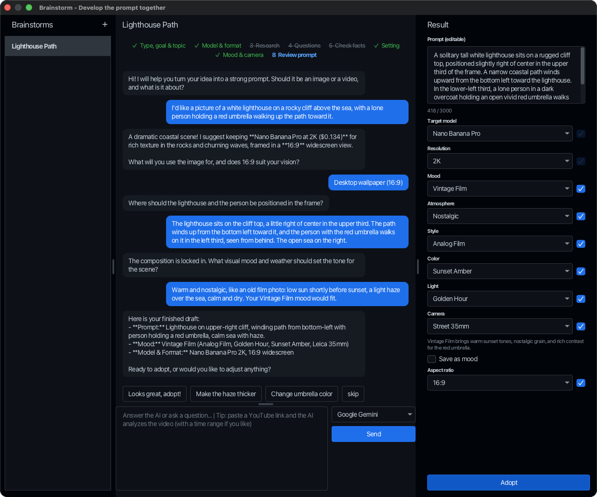

<p align="center">
  <a href="https://moodframe.art">
    <picture>
      <source media="(prefers-color-scheme: dark)" srcset="assets/moodframe-logo-on-dark.svg">
      
    </picture>
  </a>
</p>

<p align="center"><b>Mood in. Frame out.</b><br>
<a href="https://moodframe.art">moodframe.art</a></p>

MoodFrame is a desktop studio for AI images. The mood sets how an image feels, the frame its shape and size. One app
for FLUX, Nano Banana, OpenAI and any compatible image API.

<p align="center"></p>

## Mood: switch the mood, keep the picture

A mood is made of building blocks: atmosphere, style, color, light and camera. Each block can be locked, your own
blocks and moods sit next to the built-in ones, and "Mood from image" takes the mood from any picture you drop in.

| Vintage Film | Quiet Morning | Sci-Fi Cinema | Film Noir | Wild North |
|---|---|---|---|---|
|  |  |  |  |  |

Vintage Film is generated from a prompt; the other four use it as reference image (Edit). Nano Banana Pro.

## Frame: say the format once

A frame is a target aspect ratio and resolution, saved by name, with seven built-in frames. Every model takes its
closest aspect ratio and resolution, and the app shows which one before you generate. For the frame Presentation
(16:9, 2K), FLUX.2 [pro] and Nano Banana Pro make 16:9, OpenAI gpt-image makes 3:2. The library can be grouped by
frame.

## Brainstorm: from a rough idea to a finished prompt

A guided chat with Gemini or an OpenAI-compatible model works out the scene with you. It researches with the web
search of the provider: Google Search for Gemini, the built-in web search of the Responses API for OpenAI.

<p align="center"></p>

1. **Describe your idea:** a sentence is enough, or a link to a YouTube video.
2. **Answer a few questions:** the assistant asks back, researches the web and checks the facts.
3. **Adopt the draft:** prompt, mood, frame, model, resolution and saved images go to the main window with one click.
4. **Next round:** ask for the next image; one chat can plan a whole series.

It knows your moods, building blocks, frames and saved images (by their description), watches the YouTube videos you
link in the time range you choose (Gemini), and keeps every brainstorm; several run side by side.

Brainstorm needs an account with a language model *and* a web search. At every start MoodFrame checks each of your
enabled accounts: connection, language model and web search. The status bar shows the result per account, and
Brainstorm offers only the accounts that pass. The checks are small paid requests at each provider. If you use
OpenAI only (an OpenAI image model and Brainstorm with OpenAI), MoodFrame contacts no other provider at the start, so
Google and BFL are not checked. A compatible gateway takes part as soon as it answers `/responses` with the
`web_search` tool.

## And there's more

- **Combine and edit:** attach up to 10 images (depending on the model) for a collage, a combination or an edit with a
  new prompt or mood
- **Saved images:** save a logo, a word mark or a product photo once with a description and attach it again with two
  clicks; "Reuse" attaches it as well
- **Infographics:** Brainstorm gathers the facts from the web or a YouTube video and lays them out as an infographic,
  with the frame Text in Image
- **Camera dialog:** camera type, lens, aperture, perspective and shot size, with an example image for every stage
- **Video:** video clips with Gemini Omni, in the same chats as your images
- **Costs in view:** the price shows before you send, the costs per image and per chat afterwards
- **One trash:** chats, images, building blocks, moods and frames, all restorable
- **Share moods:** export your moods as a file and import them on another machine
- **Seven themes:** light and dark, from Primer and Nord to Cupertino and Dracula
- **Corporate networks:** proxy settings and your own root certificates, also for networks with TLS inspection

## Models: bring your own API key

| Provider | Models |
|---|---|
| Black Forest Labs | FLUX 3 · FLUX.2 |
| Google Gemini | Nano Banana · Omni video · Brainstorm |
| OpenAI | OpenAI or your own compatible gateway · Brainstorm (with web search) |

Your keys stay on your machine, encrypted.

## Control MoodFrame from an AI agent (MCP)

AI agents on your computer, like Claude Code, read your library, change it and generate images through the MCP server
of MoodFrame. Whatever an agent creates shows in MoodFrame at once, without changing the chat, mood or frame you are
working on.

1. **Enable:** Settings → MCP → Enable MCP server. The server listens on 127.0.0.1 only, on port 8765 unless you choose
   another one.
2. **Token:** every request has to carry the token MoodFrame creates; Generate New replaces it.
3. **Connect Claude Code:** copy the command from the settings, which includes the token, and run it in a terminal:

```bash
claude mcp add --transport http moodframe http://127.0.0.1:8765/mcp --header "Authorization: Bearer <token>"
```

The tools:

- **Read:** `list_chats`, `get_chat`, `get_entry`, `get_image`, `get_capabilities`, `list_moods`, `get_mood`,
  `list_blocks`, `get_block`, `list_frames`, `list_saved_images` and `list_trash` read the chats, the images, the
  library, the saved images (e.g. logos), the trash and the models you can generate with. `get_entry`, `get_image`
  and `generate` tell each image's `downloadName`, the file name the download button gives it, like
  "Lighthouse series 2026-11-16 17.36.17.png".
- **Download:** `download_image` copies an image or video like the download button, into `~/Downloads` or another
  folder, numbered if the name is taken; the status bar tells the download.
- **Chats:** `create_chat`, `rename_chat`, `delete_chat`, `delete_entry`, `delete_image` and `cancel_generation` manage
  chats, entries and images.
- **Moods:** `create_mood`, `update_mood`, `delete_mood` and `mood_from_image`, which finds the building blocks of an
  image like Mood from image (one request to the language model of Brainstorm).
- **Building blocks and frames:** `create_block`, `update_block`, `delete_block`, `create_frame`, `update_frame` and
  `delete_frame`; the standard ones can only be read.
- **Favorites and trash:** `set_favorite` marks favorites, `restore` takes anything out of the trash; deleting always
  goes to the trash.
- **Generate:** `preview_generation` shows prompt, format and estimated cost without any request, `generate` creates
  images or a video in a chat like the send button; `savedImages` attaches saved images by their names.

> **Costs:** `generate` costs money at the provider, just like the send button; `preview_generation` tells the estimate
> first.

## Install

The installers bring their own Java runtime. MoodFrame checks for updates on every launch and updates itself.

**macOS:** paste into a terminal; the command downloads MoodFrame, installs it in Applications and starts it.

```bash
curl -L https://moodframe.art/download/launch.mac | bash
```

A download in the terminal carries no quarantine flag, so macOS opens the app right away. The app is not notarized by
Apple: if you download the .zip from [moodframe.art](https://moodframe.art/#install) instead, macOS blocks the first
launch; then click Open Anyway in System Settings → Privacy & Security.

**Windows:** [download and run the installer](https://moodframe.art/download/moodframe.exe), which also keeps MoodFrame
up to date.

**Linux:** a .deb for Debian and Ubuntu (updates come with apt) and a .tar.gz for other distributions; the commands
with the current version are at [moodframe.art](https://moodframe.art/#install). On Arch Linux, Manjaro, EndeavourOS
and Omarchy, the .tar.gz works as well; for a pacman package with a menu entry, install `moodframe-bin` from this
repository (it is not in the AUR yet). `makepkg` compiles nothing, it packages the same .tar.gz:

```bash
git clone https://github.com/Brusdeylins/moodframe.git
cd moodframe/packaging/aur/moodframe-bin && makepkg -si
```

For an update, run `git pull` and `makepkg -si` again.

Videos on Arch need the older ffmpeg library `ffmpeg4.4`, which `moodframe-bin` lists as an optional dependency:

```bash
sudo pacman -S ffmpeg4.4
```

## Written entirely by AI

Not one line of MoodFrame's code was typed by a human.

- **Planned together:** a person plans every task together with the AI: what (function, UI and UX), how (architecture)
  and when it is done (the goals to reach).
- **Written by AI agents:** the agents write the code with [Claude Code](https://claude.ai) and the
  [ASE](https://ase.tools) agent fleet and deliver the evidence that it is right: tests, an automated review and visual
  checks.
- **Accepted on evidence:** the person checks that evidence, not the code, and then tries the change live in the app.

About 42,000 lines of Java code, 27,000 lines of test code and 1,053 automated tests.

## Build and run

Requirements: Java 21 and an API key for at least one provider (BFL, Google Gemini, or an OpenAI-compatible endpoint).

```bash
./gradlew run      # start the app
./gradlew test     # run the tests
```

API keys are entered in the settings and stored encrypted in `~/.moodframe/config.properties`. The key for that
encryption is created per installation in `~/.moodframe/secret.key`. You can also pass keys as environment variables
(`BFL_API_KEY`, `GEMINI_API_KEY`, `OPENAI_API_KEY`).

## Packaging

Installers for macOS, Windows and Linux are built with [Conveyor](https://conveyor.hydraulic.dev) (`conveyor.conf`):

```bash
./gradlew deploy
```

Conveyor is free for open source projects: `app.vcs-url` points to this public repository, and the build confirms that
with Conveyor's license server. Conveyor uses its own trust store, so behind a TLS-inspecting proxy the build stops
with `Could not contact license server`; import the proxy's root certificate into Conveyor's
`runtime/Contents/Home/lib/security/cacerts` with `keytool`.

The download site is written to `build/packages/moodframe-<version>/`. Upload its content to
`https://moodframe.art/download` (`app.site.base-url`); installed apps check that address for updates on every launch.
The website itself is in [`website/`](website/).

The AUR package `moodframe-bin` for Arch Linux repackages the Linux .tar.gz of the download site
([`packaging/aur/`](packaging/aur/)). After the upload, `packaging/aur/update.sh <version>` sets the version and the
checksums in its `PKGBUILD` and `.SRCINFO`, without `makepkg`; `packaging/aur/update.sh <version> --push` also
publishes it to the AUR, which needs the AUR account and the SSH key of the maintainer. It is not published yet: the
AUR has paused the registration of new accounts.

## License

[MIT](LICENSE) © [Matthias Brusdeylins](https://brusdeylins.info). The logo is set in Space Grotesk (SIL Open Font License).

Built with Agentic Coding using [Claude Code](https://claude.ai) and [ASE](https://ase.tools).
